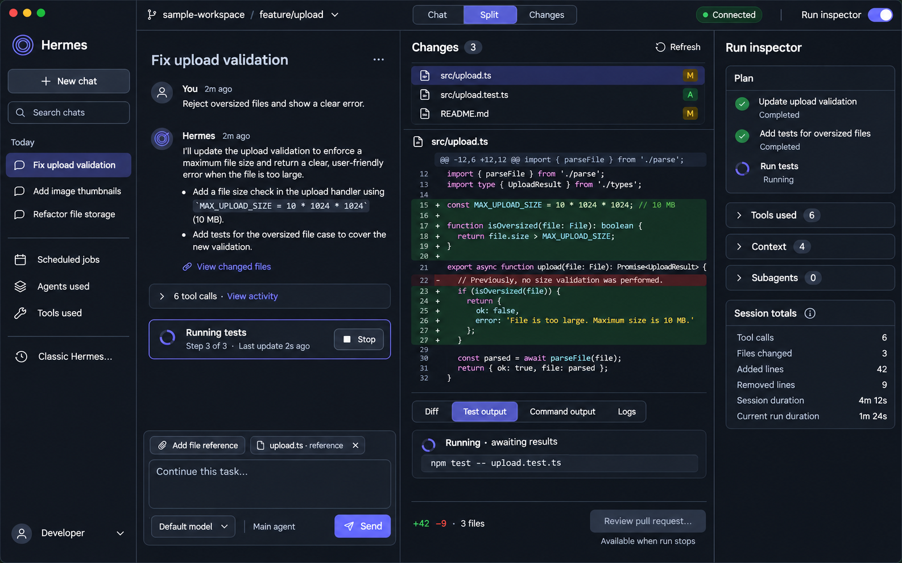
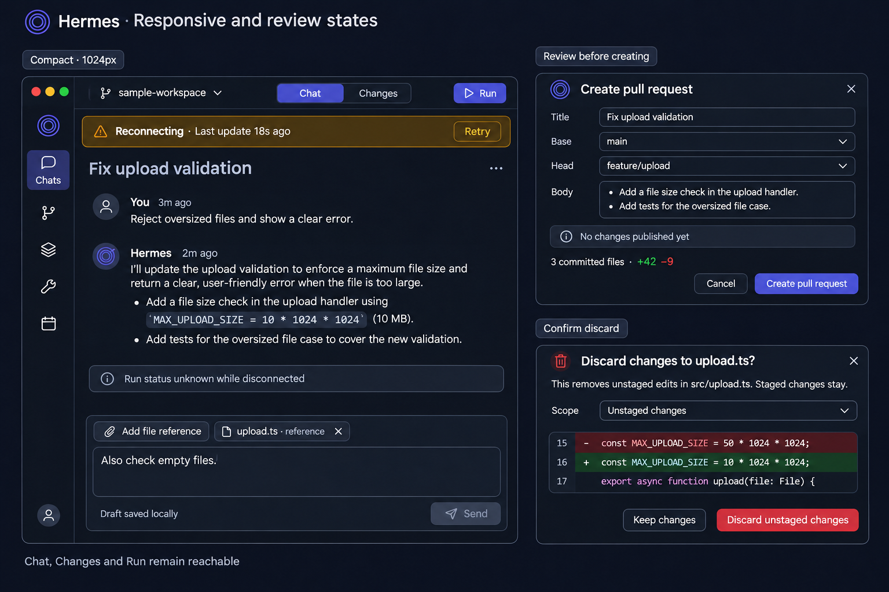

# Generated UI proposals and critique

> Historical 14 November scope. The [current full-feature packet](README.md) supersedes feature exclusions, read-only-only management and Classic fallback as a final destination. Original defect evidence remains valid.


Date: 2026-11-14. Status: proposed; awaiting user review. Built-in image generation was used. No UI code was changed. All sample content in the generated proposals is fictional.

## Read these images

1. [Initial wide workspace](assets/01-workspace-v1.png): first composition.
2. [Refined wide workspace](assets/02-workspace-v2.png): recommended direction, subject to approval.
3. [Compact, reconnecting and review states](assets/03-compact-and-review-states.png): companion state board.





## Review and rerender record

| Pass | Assessment | Result |
| --- | --- | --- |
| V1 | Reading area and changes review are clearer than the present UI, but run status repeats, the invented wing logo departs from Hermes, header bell/settings have no defined destinations, and attachment wording implies uploads that do not exist. | Rerendered as V2 with concentric-circle mark, explicit Chat/Split/Changes modes, fewer repeated status cards, no unsupported header controls, and file-reference wording. |
| V2 | Coherent wide split direction; session names readable, activity separate from prose, PR creation labelled as a review action. Current-run duration still appears inside Session totals, and Step 3 of 3 assumes an authoritative boundary. | Recommended visual hierarchy only. Implementation must move current-run metrics to a distinct section and omit them/step counts if no authoritative boundary exists. Supporting state board covers compact navigation, stale data, preserved draft, PR review and scoped discard. |
| State board | Shows a single usable narrow reading pane, explicit stale/unknown state, disabled disconnected submission, and reviewable mutation actions. | Keep as companion concept. “Run” should be implemented as **Run details** (inspector navigation), rather than a play/start action. |

These are generated concept images, not functional screenshots or pixel-accurate layout contracts. Text/code in them can contain rendering errors; do not copy the illustrated upload code into the product. The [design specification](../../superpowers/specs/2026-11-14-hermes-ui-reliability-design.md) governs behavior, labels, breakpoints and acceptance. Contrast, focus, hit targets and overflow still require actual DOM/native verification after approval. No private session screenshot was copied into these deliverable images; examples use fictional task data.

Decisions to review: dark indigo direction; Chat/Split/Changes structure; optional inspector; file references as the honest first scope; Classic as an explicit fallback; on-device draft retention; reviewed PR/discard interactions. No generated image makes a deferred feature part of the initial implementation automatically. Generated layout dimensions are illustrative: exact pane minima and native breakpoint checks are specified in the written design.

## Final generation prompt: wide V2

```text
Use case: ui-mockup. Asset type: refined desktop app design proposal, version 2. Create a sharp high fidelity flat screenshot of the Hermes Rust native macOS coding-assistant workspace at landscape 1680 by 1050 logical size. Use the attached previous proposal as visual edit target and preserve its dark indigo family, four column hierarchy, fictional sample task and legible developer-tool density, but simplify repeated boxes and fix action semantics. Entire app visible, no perspective or device. Specific refinements: (1) replace wing logo with simple concentric-circle Hermes mark; remove bell and gear icons because no destinations specified. (2) one coherent top toolbar with 'sample-workspace / feature/upload', labeled 'Connected', layout segmented control 'Chat | Split | Changes' with Split selected, and labeled 'Run inspector' toggle. (3) left sidebar 224px: New chat, Search chats, unique session rows 'Fix upload validation', 'Add image thumbnails', 'Refactor file storage', then Scheduled jobs, Agents used, Tools used, and text 'Classic Hermes…' as a clear legacy destination. No Inbox duplicate. (4) Conversation column is at least 480px, borderless reading surface with title 'Fix upload validation', a user request, and a correctly formatted short Hermes response containing two bullets, inline code and a link 'View changed files'. One quiet disclosure '6 tool calls · View activity'. Show exactly ONE current-run status strip in conversation: 'Running tests', 'Step 3 of 3', 'Last update 2s ago', and Stop button. No second running-status card in inspector. (5) lower composer labels 'Add file reference', a removable chip 'upload.ts · reference', large readable empty textbox 'Continue this task…', model 'Default model' with small scope label 'Main agent', and Send button. Do not imply binary image upload. (6) middle Changes region: header 'Changes 3' with 'Refresh', complete file list three rows src/upload.ts M, src/upload.test.ts A, README.md M. Unified diff with readable code, +/- glyphs and line numbers, neutral dark editor surface. Bottom output tabs read 'Diff', 'Test output', 'Command output', 'Logs'; Test output selected and the content says 'Running · awaiting results' with one monospace command 'npm test -- upload.test.ts'. This area is output, not interactive PTY. (7) Right optional run inspector 280px has no extra duplicate run card; header 'Run inspector', concise section 'Plan' with two done items and one running item. Below disclosures 'Tools used 6', 'Context 4', 'Subagents 0'. A quiet 'Session totals' definition list, distinguish session duration from current run. (8) Changes footer '+42 −9 · 3 files' and secondary action 'Review pull request…' disabled while current run is active, with short label 'Available when run stops'. No action labelled Open PR creating content. Reserve primary indigo for selected view and Send; use neutral New chat, subtle selected session. Palette ink #10141C panels #171D28 border #303B4A text #EDF2F7 muted #A1ADBF indigo #7878F5 success teal amber stale; no gradients, glow, marketing graphics, or decorative stats cards. SF Pro-like sans text, monospace only code. Strong readable contrast, modest 6–8px corner radii, disciplined dividers and spacing. Avoid tiny metadata and truncated session names. Use only fictional data; no private data from other conversation images. Keep all features coherent; this is a proposal and not a functional screenshot.
```

## Final generation prompt: companion states

```text
Use case: ui-mockup. Asset type: companion state-review board for a proposed native desktop app, not working software. Generate a high fidelity landscape design review board, approximately 1800x1200. Use the referenced Hermes version 2 screenshot solely as style reference, preserving dark navy, indigo, concentric-circle Hermes logo, SF Pro-like typography and fictional sample task. Three clearly readable UI examples on a flat dark board, no perspective or laptop. Small board title 'Hermes · Responsive and review states'. Left 58 percent of board: one complete COMPACT macOS app window labelled 'Compact · 1024px'. It has a 56px left icon rail with a labelled 'Chats' button that opens a searchable named-session drawer, and no anonymous dot session list. Top toolbar 'sample-workspace', view tabs Chat / Changes with Chat selected, and Run button. In compact view show ONLY the conversation column, not crushed code or inspector. A full-width amber inline status banner reads verbatim 'Reconnecting · Last update 18s ago' and 'Retry'. Conversation task 'Fix upload validation', fictional short user message and one formatted Hermes response. A text line 'Run status unknown while disconnected' rather than a false completed or running claim. Bottom composer visibly preserves text 'Also check empty files.' and chip 'upload.ts · reference', 'Add file reference' control, disabled 'Send', with helper 'Draft saved locally'. Small label under this window 'Chat, Changes and Run remain reachable'. Right top 42 percent: a focused dialog example labelled 'Review before creating'. Title 'Create pull request', clearly labelled fields Title 'Fix upload validation', Base 'main', Head 'feature/upload', Body containing two short bullet lines, and summary '3 committed files · +42 −9'. A neutral notice 'No changes published yet'. Bottom buttons Cancel and 'Create pull request'. Include a close icon with proper spacing, and no empty page behind. Right bottom: a focused dialog example labelled 'Confirm discard'. Title 'Discard changes to upload.ts?', concise text 'This removes unstaged edits in src/upload.ts. Staged changes stay.' Show selected scope 'Unstaged changes' and small real-looking 3-line red/green diff preview. Buttons 'Keep changes' and a red 'Discard unstaged changes'. No claim of undo or recoverability. Fictional content only. Make typography legible, exact action labels short, adequate space. Use semantic amber only for stale state and red only for discard. Do not show fake successful results, generic metrics, wing logos, promotional illustrations, unsupported buttons, gradients, glow, or private data. This board should make the proposed compact layout and safe action semantics reviewable at a glance; details remain illustrative.
```

